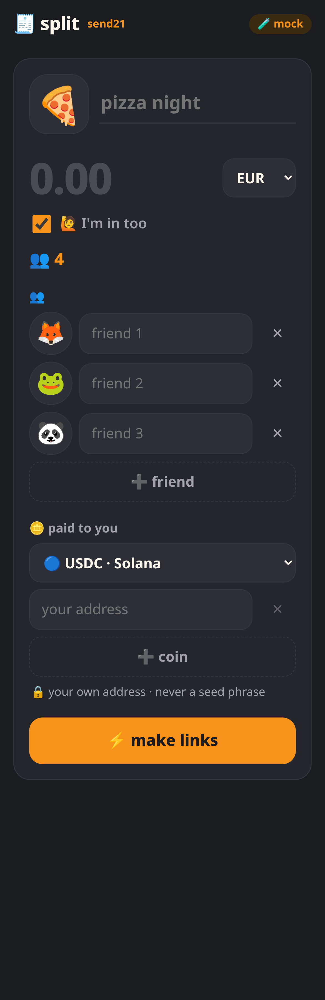
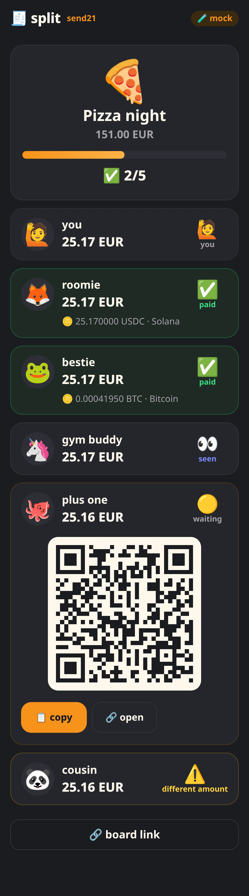
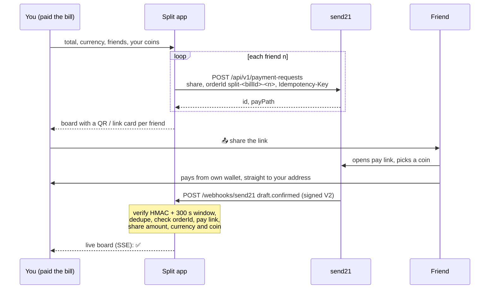

# send21 split the bill 🍕

**Someone paid? Split it in 10 seconds: one crypto pay link per friend, and a live board that fills up with ✅.** Built on [send21](https://send21.io), crypto pay links and API for people and AI agents.

<p>
  
  
</p>

<sub>Mock-mode screenshots at phone size, not real payments.</sub>

- 🪙 Friends pay in BTC (on-chain or ⚡ Lightning), USDC, USDT, EURC, SOL or ETH
- 🔒 Non-custodial: the money goes from each friend's wallet straight to yours
- 📊 The board updates live from signed send21 webhooks

## Quickstart

1. **Try it now, no key:** `npm install && npm run dev`, then open http://localhost:3000. Mock mode: tap a friend, open the link and simulate 👀 / ✅ / ⚠️ / ⌛.
2. **send21 key.** On [send21.io/api-keys](https://send21.io/api-keys), create a key with `drafts:write` (add `webhooks:manage` for step 4).
3. **Configure.** `cp .env.example .env` and fill in `SEND21_API_KEY` and `PUBLIC_URL`.
4. **Webhook.** Put the app behind your own HTTPS address (for example a reverse proxy with a free Let's Encrypt certificate, and `TRUST_PROXY=1`), then run `npm run webhook:register` and paste the printed `SEND21_WEBHOOK_SECRET` into `.env`.
5. **Run.** `npm run build && npm start`.

## How it works

You enter the total, the currency, your friends (names optional, emoji avatars) and your own receiving coins and addresses. The app splits the total fairly in cents: shares differ by at most one cent, and the remainder goes to the first person or persons. With 🙋 *I'm in too* that's you, so friends never pay an extra cent (100.00 EUR / 3 → you 33.34, friends 33.33 each). For each friend the app creates one send21 **payment request**: a pay link for exactly that share, offering your coins, with `orderId` `split-<billId>-<n>` sent as the Idempotency-Key too. A retry after a failure returns the same link, never a second one. Each friend gets a big QR and a 📤 share / 📋 copy card. They pick a coin on the send21 pay page (the rate locks for 15 minutes) and pay from their own wallet.



| Webhook | Board |
| --- | --- |
| *(link open)* | 🟡 waiting |
| `draft.seen` | 👀 seen |
| `draft.confirmed` (matches that share) | ✅ paid |
| `draft.confirmed` (does **not** match) | 🚩 check, never ✅ |
| `draft.amount_mismatch` | ⚠️ different amount |
| `draft.mismatch_accepted` → `draft.confirmed` | 👍 → ✅ paid · ≈ accepted |
| `draft.mismatch_rejected` / `draft.mismatch_unresolved` | ↩️ declined / ⚠️ undecided |
| `payment_request.expired`, `draft.expired` | ⌛ expired |

Payments up to `SPLIT_SHORTFALL_PERCENT` (default 2%) short, such as exchange withdrawal fees, are accepted automatically through send21's `shortfallPolicy`. Other different amounts wait for the owner of the send21 account to accept or decline them on send21.

**Fees.** The app's send21 account pays one small send21 fee per paid share (0.49% on small payments, at least $0.01). You always receive the full share. See [pricing](https://send21.io/pricing).

## Security notes

- **Signature V2 only.** Every delivery is checked with `X-Send21-Signature-V2`: HMAC-SHA256 over `<t>.<delivery id>.<raw body>`, constant-time compare, refused when more than **300 s** old or in the future. A bad signature gets `401` and nothing is stored.
- **Dedupe on both sides.** send21 dedupes on its side (retries reuse the same `X-Send21-Delivery` id, and one pay link is one payment). The receiver still runs its own duplicate check: a delivery id, or the same event body under a new id, is applied once. The delivery id and the board update are written together before the `2xx`, so a restart cannot apply it twice. A failed write answers `500` so send21 retries.
- **Checked per person before ✅.** A `draft.confirmed` must match that friend's share: `orderId`, pay link id, fiat currency, exact share amount (integer cents), a coin and network you offered, a txId and `status: Confirmed`. A payment for the whole bill, or for someone else's share, is 🚩, never ✅. Paid is final; late or out-of-order events never undo it.
- **Your addresses only.** Addresses are shape-checked per network; anything that looks like a seed phrase or private key is refused. send21 never asks for one.
- **The board link is the key.** Bills have a random 20-character id (about 103 bits). Anyone with the board link sees names, shares and status, so share pay links with friends and keep the board link to yourself. The browser never gets pay link ids or other internals.
- **Hardened web app.** Strict CSP (`'self'` only, no inline script or style), no `innerHTML` with user text, names are plain text (no links, markup or hidden or bidi characters), JSON bodies capped at 16 KB, bill creation rate-limited per IP (429 + Retry-After). The API key stays on the server and is never logged; a send21 key cannot move funds anyway.
- **Data.** One JSON file (`DATA_FILE`, mode 600). For several processes, use SQLite or Postgres. The form remembers your coins in this browser's localStorage.

## Develop

```bash
npm run check   # typecheck + lint + tests (fair split incl. a 20 000-case fuzz, signature, dedupe, matching, API)
```

API reference: [send21.io/docs](https://send21.io/docs) · [webhooks](https://send21.io/docs/webhooks) · [llms-full.txt](https://send21.io/llms-full.txt). More examples: [send21-examples](https://github.com/send21io/send21-examples).

Questions: [info@send21.io](mailto:info@send21.io). License: [MIT](LICENSE).
